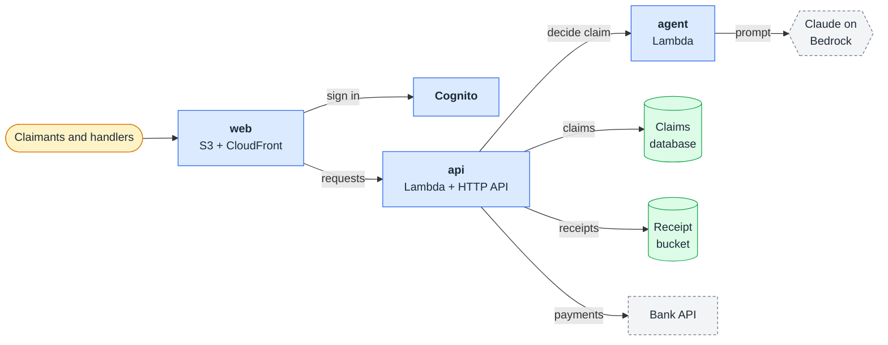

# travel-claims

**An AI agent decides routine travel insurance claims in minutes, so handlers spend their time only on claims that need judgement.**

[Claimants](#-claimants) · [Handlers](#️-handlers) · [Apps](#-apps)

> This is [sdlc-template](https://github.com/euginevd/sdlc-template), with `travel-claims` as its worked example. To start a project from it: [guides/01-agentic-sdlc.md](guides/01-agentic-sdlc.md), section 2.

## 🧳 Claimants

1. Sign in and start a claim: tell us what happened, then add your receipts (PDF, JPEG or PNG).
2. Track it on the claim page: **Submitted**, then **Approved**, **Declined** or **Referred** to a handler, then **Paid**.
3. Every decision shows its reasons and the policy wording it relies on. Not happy with it? Ask for a person to review it.

## 🗂️ Handlers

1. The queue shows what's waiting, decided today and paid this week.
2. Open a claim to see the claimant's story, the receipts and the agent's decision with its reasons.
3. Approve, decline or send it back. Claims the agent approves under $1,000 are paid automatically *(in `dev`; `prod` after the bank's sign-off)*; everything else waits for you.

## 📦 Apps

Full data flow and trust boundaries: [threat-model.md](docs/threat-model.md).

| App | What | Runs on |
|-----|------|---------|
| `web` | Claimants submit and track claims; handlers review them | S3 and CloudFront |
| `api` | Claims, receipts, decisions and payments | Lambda behind an HTTP API |
| `agent` | Decides each claim against the policy wording | Lambda, Claude on Bedrock |

Developers: [AGENTS.md](AGENTS.md), then [docs/](docs/).
