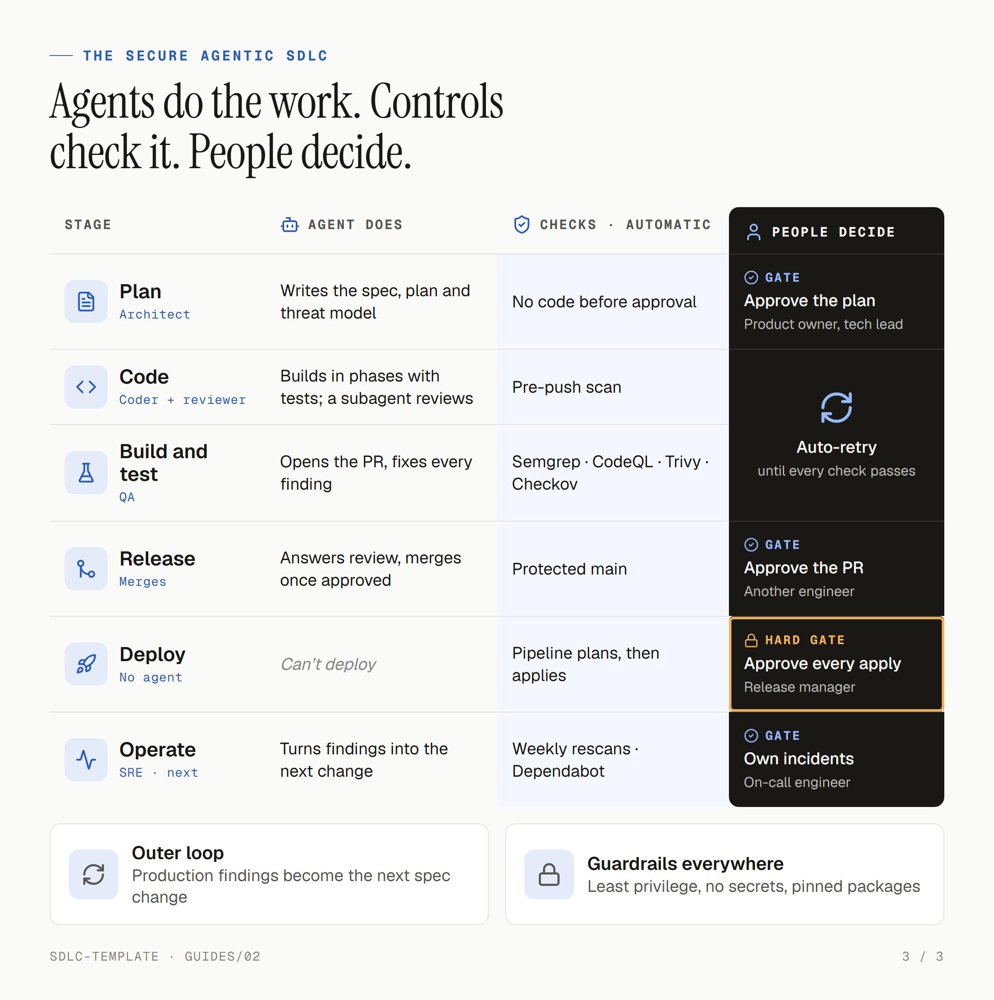

<div align="center">

# sdlc-template

**Start every project with AI coding agents that plan before they code, and checks that catch what they miss.**


[Quick start](#quick-start) · [What you get](#what-you-get) · [Built with](#built-with) · [Guides](#guides)

<br>

<picture>
  <source media="(prefers-color-scheme: dark)" srcset="guides/assets/lifecycle-dark.png">
  
</picture>

</div>

## Quick start

```bash
gh repo create my-project --template euginevd/sdlc-template --private --clone
cd my-project
bash scripts/setup.sh        # tools and the pre-push scan (--check only reports)
bash scripts/protect-main.sh # GitHub security features and the main ruleset
```

Then kick off: your agent asks whether this is a `prototype` or `production`, then drafts the business context and spec from your notes, with a design system and a mockup of the MVP if there's UI, and for production the threat model and costs that apply. You approve each, and record which [trade-offs](guides/02-security-trade-offs.md) you accept in `docs/decisions.md`, before the first piece of work. Full steps: [guides/01-using-the-template.md](guides/01-using-the-template.md), sections 1 to 3.

## What you get

| | |
|---|---|
| **Two profiles** | `prototype`: speed first, with full autonomy for the agent to plan, build, merge and deploy to `dev`. `production`: approval first, with you signing off the plan and a second reviewer, enforced by GitHub, approving each PR and each deploy |
| **Agent rules** | [AGENTS.md](AGENTS.md), read by Claude Code, Codex, Cursor, Copilot and most coding agents: plan before code, build in reviewed phases, one PR per plan, never push to `main` |
| **Spec-driven docs** | [docs/](docs/): business context, spec, plan, threat model, decisions, design system and costs, which the agent reads and keeps current |
| **Security checks** | A scan on every push, and on every PR: SAST, secrets, dependencies, IaC and a security summary comment the agent fixes from |
| **Infrastructure** | Terraform on AWS through GitHub OIDC: plan with a read-only role, apply with approval, `dev` on merge (unattended for a prototype) and `prod` by hand |
| **A starter** | [apps/api/](apps/api/), a Lambda with a `/health` route, and [infra/aws/api/](infra/aws/api/), which deploys it, to keep, build on or replace; [docs/](docs/) describes it, with a line to fill in for each thing your project decides |

## Built with

| Tool | What it does here | Where |
|------|-------------------|-------|
| Terraform | AWS infrastructure, one root per app | [infra/aws/](infra/aws/) |
| GitHub Actions | App checks, security scans, Terraform plan and apply | [.github/workflows/](.github/workflows/) |
| Python, uv | Apps, scripts and one locked workspace | [pyproject.toml](pyproject.toml) |
| Semgrep, CodeQL | Static analysis | [security.yml](.github/workflows/security.yml), [codeql.yml](.github/workflows/codeql.yml) |
| Gitleaks | Secrets in code and history | [pre-push-scan.sh](.lefthook/pre-push-scan.sh) |
| Trivy, Checkov | Vulnerable packages, images and IaC misconfiguration | [security.yml](.github/workflows/security.yml) |
| Infracost | Cost of each Terraform change, as a PR comment | [aws.yml](.github/workflows/aws.yml) |
| Lefthook, Dependabot | The pre-push scan; weekly package updates | [lefthook.yml](lefthook.yml), [dependabot.yml](.github/dependabot.yml) |

## Guides

1. [Using the template](guides/01-using-the-template.md): what you say and what the agent does, end to end, for a prototype or a production project, with a tour of every file.
2. [Security trade-offs](guides/02-security-trade-offs.md): the risks the template accepts, and the fix for production.

To contribute, read [CONTRIBUTING.md](CONTRIBUTING.md); report vulnerabilities through [SECURITY.md](SECURITY.md). MIT licence.
