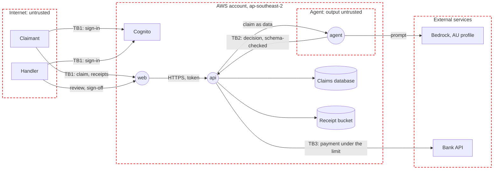

# Threat model

A worked example: `travel-claims`. STRIDE on the data flow below; each risk maps to the OWASP lists that fit the app: Top 10:2025 (A), API Security Top 10:2023 (API), LLM Top 10:2025 (LLM) and Agentic Top 10:2026 (ASI). Optional: delete it if the project has no users, data or secrets to protect.

## Data flow

Rectangles are external entities, circles processes, cylinders data stores, red dashed boxes trust boundaries; TB labels mark the flows that cross a boundary.

| ID | Data | Class | Where |
|:-:|------|-------|-------|
| D1 | Passports, bank details, medical records | Highly sensitive | Claims database and receipt bucket, in Australia (business 4) |
| D2 | Claim decisions and their reasons | Confidential | Claims database |
| D3 | Policy wording and the claims manual | Internal | Read by the agent |

## Trust boundaries

- **TB1** Internet to AWS: claimants and handlers sign in through Amazon Cognito (business 6); everything they send is untrusted, receipts included.
- **TB2** Agent to the `api`: model output is untrusted; code checks the decision before it can drive a payment.
- **TB3** AWS to external services: payments go to the bank API, and model calls stay in Australia.

## Top risks

STRIDE: Spoofing, Tampering, Repudiation, Information disclosure, Denial of service, Elevation of privilege.

| ID | Risk | STRIDE | OWASP | Rating | Controls | Enforced at |
|:-:|------|:------:|-------|:------:|----------|-------------|
| R1 | Prompt injection in a receipt makes the agent approve a bad claim | T, E | LLM01, ASI01 | High | Content kept apart from instructions (code-standards 18), limits in code (spec 15), injection tests | Test, Monitor |
| R2 | The agent pays more than the policy allows | T, E | LLM06, ASI02 | High | Payment code checks every limit (spec 13) and fails closed (code-standards 7) | Code, Test |
| R3 | One claimant sees another's claim | I | A01, API1 | High | Authorisation on every request (code-standards 10), abuse-case tests (code-standards 11) | Code, Test |
| R4 | Personal data leaks into logs | I | A09, LLM02 | Medium | Redaction at the source (code-standards 8), a test against real receipts *(planned, status 10)* | Code, Test |
| R5 | Claim data leaves Australia through model calls | I | LLM02 | Medium | The Australian inference profile (spec 16) | Deploy |
| R6 | Runaway model calls run up the bill | D | LLM10, API4 | Medium | Model call limits (code-standards 19), the `dev` budget (spec 19) | Code, Operate |
| R7 | A compromised package or image | T | A03, LLM03 | Medium | Pinned week-old versions, SHA-pinned allowed actions only, Dependabot, Trivy on every push and PR and weekly | Code, Build, Operate |
| R8 | A secret is committed | I | A07 | Medium | The pre-push scan, GitHub push protection, OIDC with no long-lived keys | Code, Deploy |

## Compliance

- Privacy Act and the Notifiable Data Breaches scheme: a privacy impact assessment before go-live; suspected breaches assessed within 30 days.
- APRA CPS 234: controls tested yearly; APRA told within 72 hours of a material security incident.
