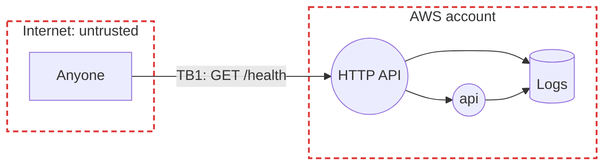

# Threat model

A starter: the model of the sample the template ships, for kickoff to extend; every project keeps it, and a prototype extends it only if asked. It answers the four threat-modelling questions: what are we building (the data flow), what can go wrong and what do we do about it (the risks and their controls), and did we do a good job (the review line). STRIDE on the data flow; each risk maps to the OWASP lists that fit the app: Top 10:2025 (A), API Security Top 10:2023 (API), LLM Top 10:2025 (LLM) and Agentic Top 10:2026 (ASI).

Reviewed: *(to fill in)* the date, by whom, and the PR, each time a change touches users, data, auth or endpoints.

## Data flow

Rectangles are external entities, circles processes, cylinders data stores, red dashed boxes trust boundaries; TB labels mark the flows that cross a boundary.

| ID | Data | Class | Where |
|:-:|------|-------|-------|
| D1 | Access logs: caller IP, route, status | Internal | CloudWatch, kept 30 days |
| D2 | *(to fill in)* each kind of data the project holds | | |

Class: Public (anyone may see it), Internal (the team), Confidential (named people; customer or personal data) or Restricted (secrets, payments, health).

## Trust boundaries

- **TB1** Internet to AWS: `/health` takes no sign-in, so everything a caller sends is untrusted. *(to fill in)* how users sign in, once there are any, and a TB line for each further boundary, such as an outside service.
- **With a model:** its output and everything it reads are untrusted, a boundary of their own; and no part of the app holds private data, reads untrusted content and can send data out, all three together (the lethal trifecta).

## Top risks

STRIDE: Spoofing, Tampering, Repudiation, Information disclosure, Denial of service, Elevation of privilege. Rating: likelihood times impact, as Low, Medium or High.

| ID | Risk | STRIDE | OWASP | Rating | Controls | Enforced at |
|:-:|------|:------:|-------|:------:|----------|-------------|
| R1 | A flood of requests to the public route runs up the bill | D | API4 | Low | Throttling on every route, the budget emails when set (costs 5) | Deploy, Maintain |
| R2 | The public route leaks something from the request or the service | I | A01, API3 | Low | It returns a fixed body (spec 5), with a test that it echoes nothing | Build, Test |
| R3 | A new route ships without sign-in | S, E | A01, API2 | Medium | Authorisation on every request (standards 10); Checkov fails a route with no authorisation; a test that every route but `/health` refuses an unsigned call *(planned, with the first such route)* | Build, Test |
| R4 | A compromised package or image | T | A03, LLM03 | Medium | Pinned week-old versions, SHA-pinned allowed actions only, Dependabot, Trivy on every push and PR and weekly | Build, Test, Maintain |
| R5 | A secret is committed | I | A07 | Medium | The pre-push scan, GitHub push protection, OIDC with no long-lived keys | Build, Deploy |
| R6 | *(to fill in)* the project's own risks, each written like those above: its STRIDE letters, OWASP IDs, a rating, controls that cite a spec or standards number, and where each is enforced; mark a control not yet built *(planned)* | | | | | |

## Compliance

- *(to fill in)* one line for each law in `spec.md`'s Business section: what it requires here and by when, or none.
